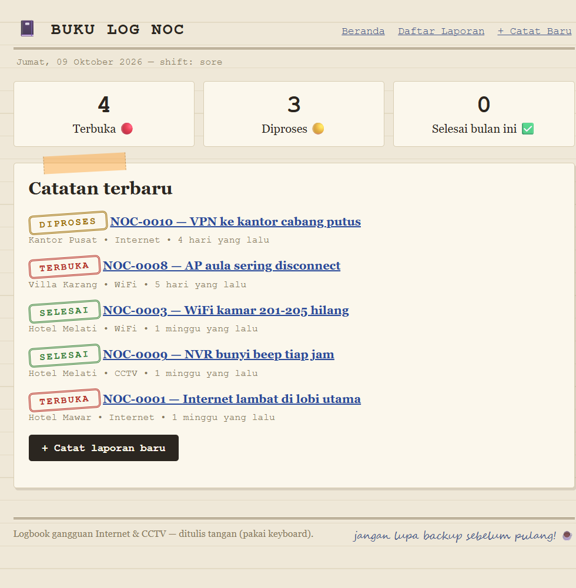
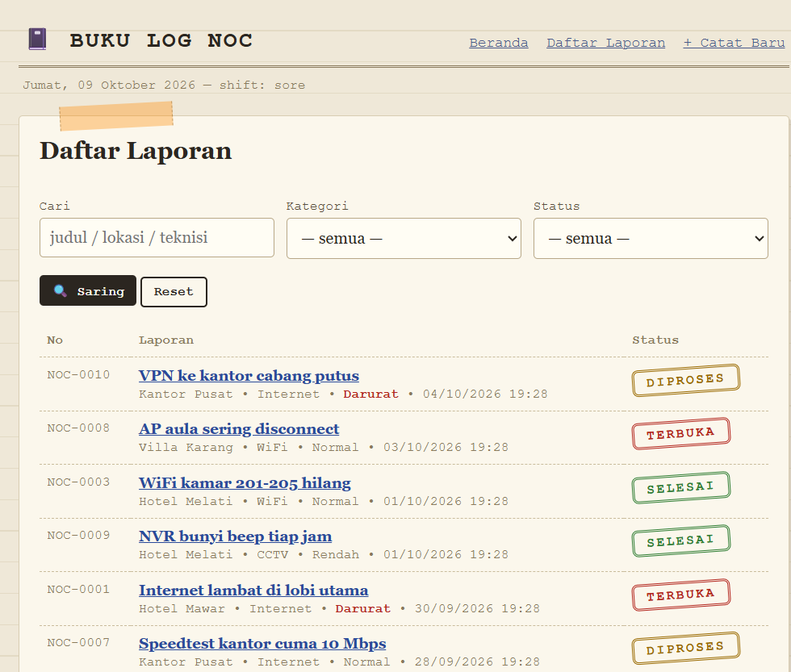
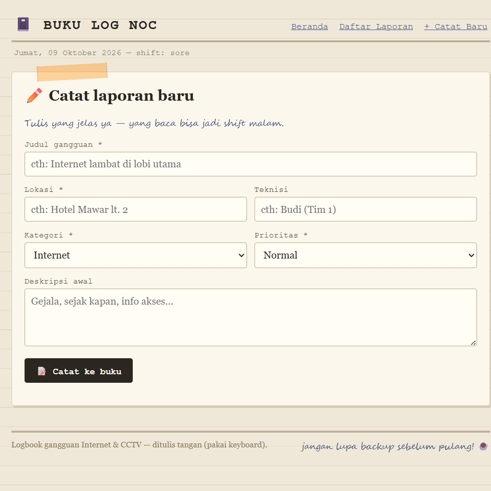

# 📓 Logbook NOC — Buku Laporan Gangguan (Laravel)

Aplikasi full-stack Laravel untuk mencatat laporan gangguan Internet / WiFi / CCTV ala **buku log kertas**: stempel status miring, selotip, catatan pinggir, dan Bahasa Indonesia. Dibuat untuk operasional IT hospitality & tim lapangan.


## Fitur

- 📊 Dashboard: hitungan Terbuka / Diproses / Selesai bulan ini + 5 catatan terbaru
- ✏️ CRUD laporan: judul, lokasi, kategori, prioritas, teknisi, deskripsi, tindak lanjut
- 🏷 Alur status Terbuka → Diproses → Selesai (tanggal selesai otomatis terisi)
- 🔍 Cari + filter kategori/status + pagination
- ✅ Validasi server-side + flash message berbahasa manusia
- 🌱 Seeder 12 laporan contoh realistis
- 🇮🇩 Locale Indonesia (tanggal, shift pagi/sore/malam otomatis)

## Tampilan

Bukan template generik: kertas krem bergaris, font serif + mesin ketik, stempel status, selotip oranye, catatan tangan di footer.

| Dashboard | Daftar + filter | Form catat |
|---|---|---|
|  |  |  |

> ℹ️ Aplikasi ini butuh server PHP + database, jadi **tidak bisa live di github.io** (yang hanya untuk situs statis). Untuk demo online, deploy ke VPS / shared hosting PHP (lihat urutan instalasi di bawah) — screenshot di atas diambil dari aplikasi yang jalan.

## Instalasi

```bash
composer install
cp .env.example .env
php artisan key:generate
touch database/database.sqlite   # di Windows: type nul > database\database.sqlite
php artisan migrate --seed
php artisan serve
```

Buka http://127.0.0.1:8000

> Butuh PHP 8.2+ dengan ekstensi: openssl, mbstring, sqlite3, pdo_sqlite, fileinfo.

## Struktur penting

```
app/Http/Controllers/DashboardController.php  # hitungan + terbaru (invokable)
app/Http/Controllers/LaporanController.php    # resource CRUD + filter + closed_at otomatis
app/Models/Laporan.php                        # fillable, casts, konstanta opsi, nomor NOC-xxxx
database/migrations/*_create_laporans_table.php
database/seeders/LaporanSeeder.php            # 12 data contoh
resources/views/layouts/app.blade.php         # tema buku kertas
resources/views/dashboard.blade.php
resources/views/laporans/{index,create,show,edit}.blade.php
```

## Alur status

`Terbuka` → `Diproses` → `Selesai`. Saat pertama kali jadi Selesai, `closed_at` terisi otomatis; kalau dibuka lagi, dikosongkan lagi.

MIT — dulkemot 2026
